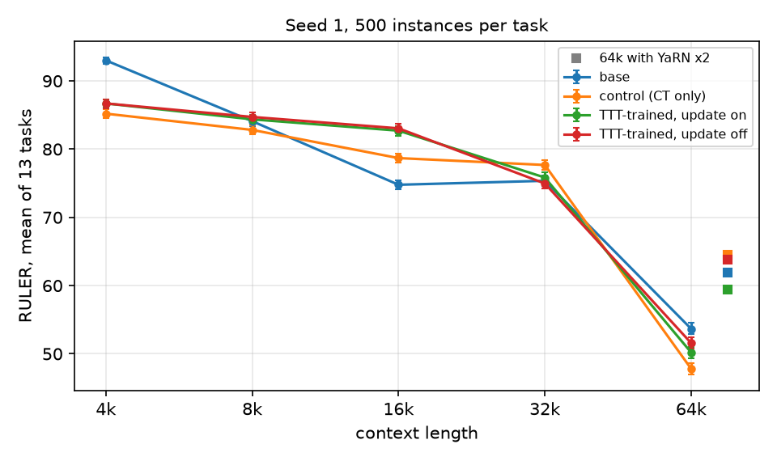
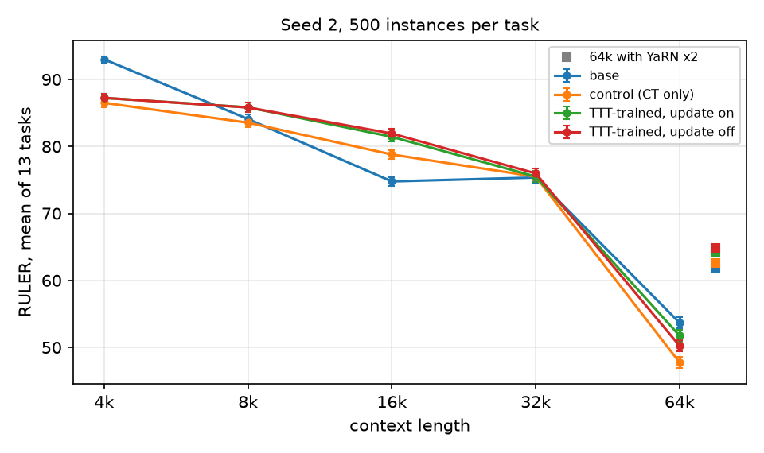

# In-Place Test-Time Training on Qwen3-4B: a controlled small-budget study

Detailed tables, run ids and failure-mode breakdowns are in [results.md](results.md); the design
is in [plan.md](plan.md), written before the runs.

## Summary

We continually pretrained Qwen3-4B-Base for 3.0B tokens at 32k context twice, once with the
released In-Place TTT recipe and once without the module, on identical data in identical order,
and evaluated both on RULER (13 tasks, 500 instances each) from 4k to 64k. Three results stand
out.

1. **The test-time update is not what helps.** Disabling the fast-weight update at inference
   (`ttt_lr = 0`) leaves the TTT-trained model's score unchanged or slightly better everywhere
   below the training length, in both seeds. At the training length itself the update's effect on
   the artifact-free tasks is +0.6 in one seed and -0.6 in the other. Whatever advantage the TTT
   arm has over the control comes from how its shared weights were trained, not from adapting at
   test time.
2. **Beyond the training length the update hurts.** At 64k with YaRN the active update costs 4.4
   points in seed 1 and 0.7 in seed 2 relative to the same weights with the update disabled; with
   plain RoPE its sign depends on the seed (-1.4 and +1.5), averaging to nothing. The seed-1
   checkpoint shows a visible failure mode at 64k, repetition loops
   on the frequent-words task after sixteen accumulated chunk updates; the seed-2 checkpoint does
   not, but both lose most of their accuracy on the hardest multi-key needle task when the update
   is active. The released inference code applies no clipping; the paper reports using a
   Frobenius-norm clip (tau = 1e-5) for its Qwen3-4B evaluations; applied to our checkpoints that
   clip neutralises the update entirely, and no inner learning rate at inference makes the update
   helpful beyond the training length.
3. **The TTT arm trains in a different regime.** On identical batches its pre-clipping gradient
   norm is two to four orders of magnitude larger than the control's, and essentially all of it
   sits in the six 76,800-parameter target convolutions. With the released `max_grad_norm = 1`
   the whole network's gradient is rescaled by about 1/50 at every step of the TTT arm while the
   control is never clipped; the TTT arm also carries a persistent training-loss penalty on the
   same batches (+0.017 early, +0.007 at the end, both seeds).

A corpus-design mistake on our side is reported in full: synthetic retrieval documents taught both
arms to answer certain RULER prompts with a new "Question:" block. It affects two tasks, is shared
by both arms, and is handled with a pre-declared sensitivity analysis.

## Questions and design

(see plan.md) Four questions: a reduced-budget replication of the paper's matched
comparison; a ablation of the test-time update; the chunk-size discrepancy between the paper's
ablation (512-1024) and the released config (4096); and behaviour across evaluation lengths.

Arms: `ttt_off` (continued pretraining only) and `ttt_on` (released recipe: TTT in every sixth
layer, learned target projection, depthwise Conv1D target, `ttt_lr = 3`, chunk 4096), both from
Qwen3-4B-Base, 1431 steps of 64 x 32,768 tokens with the released optimizer settings, two seeds;
inference variants of `ttt_on` with `ttt_lr` 0, 1, 6 and with clipping; `chunk512` and `chunk1024`
trained for 1B tokens under the main schedule. Evaluation with OpenCompass RULER as in the paper,
with the TTT inference classes registered in every worker, 500 instances per task, 64k with YaRN x2
as the primary long setting and plain RoPE as secondary.

Corpus: 3.25B tokens packed into 32,736-token sequences from PG-19 books (1.3B), arXiv (0.75B),
permissively licensed GitHub code grouped by repository (0.9B) and synthetic retrieval documents
(0.3B), globally shuffled, revisions pinned in a manifest.

## Results

### Training dynamics

Identical batches, identical step-1 loss; from step 2 the TTT arm's loss sits above the control's
by an amount that decays from about +0.02 to +0.007 over 3B tokens in both seeds. Gradient norms:
control 0.2-0.3 throughout; TTT arm from the hundreds or thousands down to about 20-30. Held-out
loss at 3B (eight held-out sequences of 16k): base 1.865, control 1.823 / 1.822 (seeds 1 / 2), TTT
arm with the update active 1.832 / 1.831, so both arms improve on the base model and the TTT arm's
0.009-nat penalty persists on held-out text.
Per-group gradient norms on the final TTT checkpoints: `ttt_conv` 49.6 / 49.2 of a total 49.6 /
49.2 (seeds 1 / 2); everything else below 1. Figures: `figures/curves_seed1.png`, `figures/curves_seed2.png`.

### RULER, seed 1

Means over the 13 tasks (intervals in results.md): base 93.0 / 84.1 / 74.8 / 75.4 / 53.7 at
4k/8k/16k/32k/64k and 61.9 at 64k with YaRN; control 85.2 / 82.8 / 78.7 / 77.7 / 47.8, YaRN 64.6;
TTT-trained 86.7 / 84.4 / 82.7 / 75.8 / 50.2, YaRN 59.5; TTT-trained with the update disabled
86.7 / 84.7 / 83.1 / 75.0 / 51.6, YaRN 63.8.

Paired decomposition (TTT minus control = update effect + training effect):

| length | TTT - control | update | training |
|---|---|---|---|
| 4k | +1.5 | 0.0 | +1.5 |
| 8k | +1.5 | -0.4 | +1.9 |
| 16k | +4.0 | -0.3 | +4.4 |
| 32k | -1.8 | +0.9 | -2.7 |
| 64k plain | +2.4 | -1.4 | +3.8 |
| 64k YaRN | -5.1 | -4.4 | -0.7 |

On the 11 tasks unaffected by the format artifact the arms are within a point of each other up to
32k; the update is worth +0.6 [0.1, 1.0] at 32k and -1.5 (plain) to -4.1 (YaRN) at 64k.

### RULER, seed 2

Means over the 13 tasks: base as above; control 86.5 / 83.5 / 78.8 / 75.5 / 47.8 at
4k/8k/16k/32k/64k and 62.6 at 64k with YaRN; TTT-trained 87.3 / 85.8 / 81.4 / 75.5 / 51.7, YaRN
64.2; TTT-trained with the update disabled 87.3 / 85.8 / 81.9 / 76.0 / 50.2, YaRN 64.9.

| length | TTT - control | update | training |
|---|---|---|---|
| 4k | +0.7 | 0.0 | +0.7 |
| 8k | +2.3 | 0.0 | +2.3 |
| 16k | +2.6 | -0.5 | +3.1 |
| 32k | 0.0 | -0.5 | +0.5 |
| 64k plain | +4.0 | +1.5 | +2.5 |
| 64k YaRN | +1.7 | -0.7 | +2.3 |

On the 11 artifact-free tasks the update is worth -0.6 [-1.0, -0.2] at 32k (seed 1: +0.6 [0.1,
1.0]) and -0.5 at 16k; the training effect is +0.9 at 16k (seed 1: +0.8) and -0.4 at 32k (seed 1:
+0.2). The 32k update effect therefore changes sign between seeds with each seed's interval
excluding zero: its seed-to-seed spread is about a point and its two-seed mean is zero, and the
paper's +0.6 at 32k lies inside that spread. The format artifact also varies with the seed: the
seed-2 control keeps the "Question:" habit on `niah_single_2` at 32k (31% of answers, against
1-3% for the seed-1 control), which is why the 13-task gap between the arms at 32k is 0.0 here
and -1.8 in seed 1. Below the training length the picture is the same in both seeds: training
with the module helps by 2-3 points on the 13 tasks and by about a point on the clean tasks at
16k, and the update adds nothing or costs half a point. At 64k with YaRN the update costs 0.7
(13 tasks) and 1.1 (clean tasks), far less than seed 1's 4.4: this checkpoint does not fall into
the frequent-words repetition loop (`fwe` 93.5 with the update active). The 64k failure common to
both seeds is on `niah_multikey_3`, where the active update turns 19.0 into 4.2 (seed 1: 8.0) by
returning another uuid from the haystack or restating the prompt where the frozen weights answer
correctly. The seed-2 TTT arm nevertheless ends 1.7 ahead of its control on the 13 tasks, because
that control is weaker on `niah_single_2` than the seed-1 control (43.6 vs 73.0), and 0.8 behind
on the clean tasks. With plain RoPE at 64k the update's sign flips a second time: +1.5 (13 tasks)
and +2.2 (clean tasks) in seed 2 against -1.4 and -1.5 in seed 1. The seed-2 gain comes from
`niah_single_1`, where beyond the window the frozen weights mostly answer with a new "Question:"
block and the active update restores the number (36.2 to 63.4; 148 instances repaired against 12
broken), while `niah_multikey_2` and `niah_single_3` lose 4-8 points under the update in both
seeds.

### Both seeds under the planned rule

Averaging the paired differences over seeds per instance (tables in results.md): on the 13 tasks
TTT beats the control at 4k, 8k and 16k (+1.1, +1.9, +3.3; same sign in both seeds) and not at
32k (-0.9; one seed negative, one zero). On the 11 artifact-free tasks it beats the control at 16k
only (+0.6 [0.3, 0.8]). Every one of those gains is a training effect (+1.1 to +3.8; +0.9 at 16k on
the clean tasks); the seed-averaged update effect is 0.0 / -0.2 / -0.4 / +0.2 at 4k / 8k / 16k /
32k on the 13 tasks and 0.0 / -0.0 / -0.3 / -0.0 on the clean ones. The planned noise floor,
the difference between the two seeds of the same arm, is at most 0.3 points on the clean tasks at
4k-16k, 1.2 at 32k for the TTT arm with the update active and 0.0 for the same weights with the
update disabled: the seed dependence at the training length lives in the test-time update. At 64k
with YaRN the rule finds TTT worse than the control on the clean tasks (-2.3 [-2.8, -1.9], both
seeds negative) and gives no verdict on the 13 tasks; the seed-averaged update effect is -2.5 /
-2.6 (13 / 11 tasks), negative in both seeds, and the two seeds' TTT arms differ by 4.8 points with
the update active against 1.1 with it disabled. With plain RoPE at 64k TTT beats the control on
both task sets (+3.2 and +3.5, both seeds positive), again entirely through training (+3.1): the
seed-averaged update effect is +0.1 and +0.4, the mean of one negative and one positive seed.
Across the six length settings the seed-averaged update effect never exceeds +0.4 and is -2.5 at
64k with YaRN, while the training effect is +0.9 to +3.8 wherever the arms differ at all.

### Inference-time sweep and clipping

On the seed-1 TTT checkpoint, inner learning rates 0, 1, 3 (trained) and 6 at inference give
75.0, 75.5, 75.8 and 74.1 at 32k and 51.6, 50.1, 50.2 and 48.2 at 64k (plain RoPE). The update's
benefit at the training length is at most +0.9 and only at the trained rate; at 64k every non-zero
rate hurts, increasingly with the rate (frequent-words accuracy 73.5, 63.7, 59.3, 2.7). The
paper's clipping (tau = 1e-5) makes the model indistinguishable from the frozen variant at both
lengths (74.8 and 51.7): the threshold is so far below the trained model's delta norms that it
removes the update rather than stabilising it.

### Chunk size

At 1B tokens (one third of the budget) the released chunk of 4096 is the worst of the three: on
the 11 artifact-free tasks chunk 512 beats it by +1.2 at 32k and +5.1 at 64k, and chunk 1024 by
+0.3 and +1.1. At the training length every TTT variant trails the 1B control by 1-2 points; beyond
the window (64k, plain RoPE) every TTT variant is ahead of it, by +3.9 (4096) to +9.0 (512) on the
13 tasks. With the update disabled, the three chunk sizes are within 0.4 points of one another and
of the 1B control on the clean tasks at 32k; the active update costs 2.3 points with chunk 4096,
1.6 with 1024 and 1.0 with 512, so at one third of the budget the chunk size sets how much the
update hurts rather than what the shared weights learned. At 64k with plain RoPE the frozen chunk models are
within 1.4 points of one another and lead the 1B control by 7.8 to 9.2 points on the clean tasks,
so the 64k advantage of the TTT variants is a training effect; the active update costs 3.8 (4096),
2.9 (1024) and 0.2 (512) points on top of it.

### Inference cost and fast-weight delta norms

The released module is cheap at inference: with batch size 1 on one GPU, prefill plus 64 greedy
tokens takes at most 2% longer than the control at 32k-64k (3.86 vs 3.78 s at 32k, 7.31 vs 7.28 s
at 64k) and 0.38 GB more peak memory. On held-out 32k text the accumulated fast-weight delta grows
about linearly with the number of chunks and reaches 0.4-0.9% of the down-projection's Frobenius
norm in five of the six TTT layers and 2.3-2.4% in the last one (both seeds), with no sign of
saturation, so a 64k input moves the last layer by roughly 5%. Each per-chunk delta has a norm of
0.1-0.85, four to five orders of magnitude above the paper's clipping threshold tau = 1e-5, which
is why clipping at that value removes the update instead of bounding it. The base model with a
freshly initialised module already has a `ttt_conv` gradient fourteen times the rest of the
network's (17-18 against 1.2 on 16k held-out text), so the gradient imbalance seen in training is
present from the first step.

## Limitations

* **Budget.** 3.0B tokens per arm at 32k, against the paper's 20B at 32k followed by 15B at 64k.
  The 64k training stage is absent, so our 64k numbers test extrapolation beyond the training
  length, not the paper's 64k-trained setting, and effects that need more tokens to appear would be
  missed.
* **Corpus.** A public mixture (PG-19, arXiv, GitHub, synthetic retrieval documents) that differs
  from the paper's. The synthetic documents introduced a prompt-format artifact that affects two
  RULER tasks in both arms and dominates the 13-task means at several lengths; the 11-task
  sensitivity analysis was declared after the seed-1 results (see plan.md).
* **Scope.** One model (Qwen3-4B-Base), one benchmark (RULER, 13 tasks, 500 instances, greedy
  decoding, 64 new tokens), two seeds. The inference-time sweep, the clipping test and the learning
  curve were run on seed 1 only; the chunk ablation stopped at 1B tokens; 128k was not evaluated.
* **Clipping.** Only tau = 1e-5 was tested, the value the paper reports; a sweep over tau could find
  a threshold that stabilises the 64k update without removing it.
* **Statistics.** Bootstrap intervals cover instance-sampling noise only. The planned noise
  floor (the two seeds of one arm differ by up to 2.2 points on the 13 tasks at 4k-32k, by 1.2 on
  the clean tasks at 32k, and by 4.8 at 64k with YaRN for the TTT arm with the update active) means
  single-seed differences of a point or less should not be read as effects, and
  two seeds cannot estimate the seed variance itself with any precision.
* **Upstream code.** Three small patches on the pinned In-Place-TTT commit (configuration
  validation, metrics logging, optional clipping). The training-time implementation and the
  released configuration are otherwise untouched, so any difference between the released code and
  the code behind the paper carries into these results.

## Reproducibility

Everything runs from the repository with relative paths (README). Upstream code is pinned at a
commit with three small patches; environments are pinned; the corpus manifest records dataset
revisions; every number in results.md names its job id and run directory, and tables are
regenerated from per-instance CSVs by `inplace_ttt_study.analysis`.
