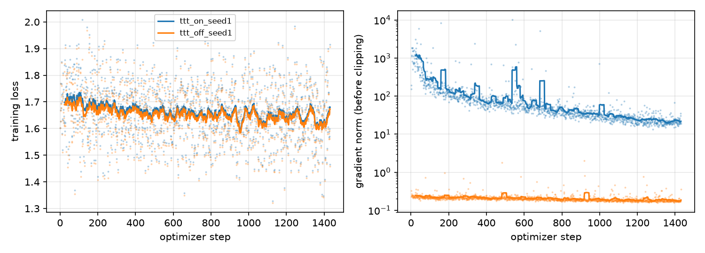
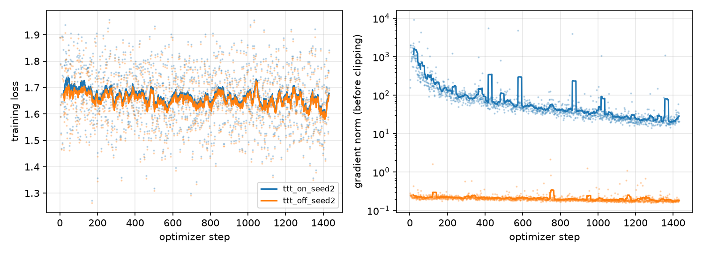

# Results

This file is filled in as runs complete. Every number links to a run directory under
`$STUDY_ROOT/checkpoints` or `$STUDY_ROOT/results/ruler`, and every table is regenerated by
`inplace_ttt_study.analysis.report` from the per-instance CSV.

## Runs

| run | tokens | notes |
|---|---|---|
| smoke | 2.6M | 10 steps on the tiny corpus; checks passed |
| corpus | 3.25B | see Corpus |
| ttt_on_seed1 | 3.0B | checkpoints at steps 477, 954, 1431 (all exported to HF) |
| ttt_off_seed1 | 3.0B | identical batches to ttt_on_seed1; checkpoints at steps 477, 954, 1431 |
| ttt_on_seed2 | 3.0B | checkpoints at steps 477, 954, 1431 |
| ttt_off_seed2 | 3.0B | checkpoints at steps 477, 954, 1431 |
| chunk512, chunk1024 | 1.0B | ttt_on recipe with ttt_chunk 512 / 1024, stopped after the step-477 checkpoint |
| eval seed 1 | - | base, ttt_on_s1, ttt_on_s1_frozen (ttt_lr=0), ttt_off_s1 at 4k-64k, 500 instances per task |
| eval seed 2 | - | the same four models for seed 2 at 4k-64k, 500 instances per task |
| eval yarn seed 1 | - | the same four models at 64k with YaRN x2 |
| eval yarn seed 2 | - | the seed-2 models at 64k with YaRN x2 |
| sweep seed 1 | - | ttt_lr 1 and 6, clipping tau=1e-5, at 32k and 64k |
| chunk eval | - | chunk 512 / 1024 / 4096 and the 1B control, 1B-token checkpoints, at 32k and 64k |
| chunk frozen | - | the three 1B chunk checkpoints with ttt_lr=0 at 32k and 64k |
| learning curve seed 1 | - | 2B-token checkpoints (step 954) of both arms, plus the TTT one frozen, at 32k and 64k |
| diagnostics seeds 1, 2 | - | checks, gradient norms by group and inference cost of both final checkpoints, delta norms of the TTT one, base-model gradient norms |
| pilot_ttt_on | 70M | 33 steps of the real 1431-step schedule on the pilot corpus; loss 1.47 at step 1, 1.5-2.0 through warmup and at peak lr, gradient norm 400-1650 before clipping; no divergence |

## Corpus

Built by `scripts/build_data.sh` (`data/corpus/manifest.json`).

| source | dataset (revision) | sequences | tokens |
|---|---|---|---|
| books | emozilla/pg19 (c021754) | 39,712 | 1.300B |
| arxiv | ccdv/arxiv-summarization (240aaf1) | 22,911 | 0.750B |
| code | codeparrot/github-code-clean (c48d40f), permissive licenses, grouped by repository | 27,493 | 0.900B |
| synthetic | key-value and planted-fact retrieval documents | 9,165 | 0.300B |
| total | 64 shards + 64 held-out sequences | 99,217 | 3.250B |

Every sequence re-tokenizes to between 32,704 and 32,737 tokens (none over the 32,768 limit), so a
step of 64 sequences is 2.09M tokens and 1431 steps consume 91,584 of the 99,217 sequences.

## Calibration of the evaluation harness

Base Qwen3-4B-Base, 100 instances per task, OpenCompass RULER.

| length | mean of 13 tasks | reference |
|---|---|---|
| 4k | 93.5 | paper's continually trained baseline 96.6; Qwen3 report (post-trained, non-thinking) 95.1 |

## Main comparison

### 4k (seed 1, 500 instances per task, no fast-weight updates fire at this length)

| task | base | ttt_on | ttt_on, ttt_lr=0 | ttt_off |
|---|---|---|---|---|
| cwe | 93.9 | 96.4 | 96.4 | 95.8 |
| fwe | 90.3 | 89.1 | 89.1 | 89.8 |
| niah_multikey_1 | 93.8 | 82.0 | 82.0 | 64.6 |
| niah_multikey_2 | 99.0 | 99.4 | 99.4 | 98.8 |
| niah_multikey_3 | 99.6 | 99.6 | 99.6 | 99.8 |
| niah_multiquery | 99.3 | 98.7 | 98.7 | 98.2 |
| niah_multivalue | 99.1 | 99.8 | 99.8 | 99.8 |
| niah_single_1 | 100.0 | 99.8 | 99.8 | 99.8 |
| niah_single_2 | 100.0 | 36.0 | 36.0 | 35.4 |
| niah_single_3 | 100.0 | 98.4 | 98.4 | 98.8 |
| qa_hotpotqa | 54.2 | 50.8 | 50.8 | 49.6 |
| qa_squad | 80.0 | 77.2 | 77.2 | 76.8 |
| vt | 100.0 | 100.0 | 100.0 | 100.0 |
| mean (95% bootstrap interval) | 93.0 [92.5, 93.5] | 86.7 [86.1, 87.3] | 86.7 [86.1, 87.3] | 85.2 [84.5, 85.8] |

Three observations. (1) `ttt_on` and its `ttt_lr=0` variant are identical on every instance: RULER's
4k prompts are shorter than the 4,096-token chunk, so the fast-weight update never fires, and 4k
differences are effects of training only. (2) Both continually trained arms lose about 7 points to
the base model, almost entirely on `niah_single_2`, where they answer by starting a new
"Question: ... Answer: ..." block (323 of 500 control answers, similarly for `ttt_on`) instead of
emitting the number. That is the format of the synthetic retrieval documents in the training corpus,
whose question blocks follow a passage and a blank line exactly as RULER's answer prefix does. The
artifact is shared by both arms and leaves the paired comparison intact, but it depresses absolute
scores at short context and is a limitation of the corpus design. (3) Within the matched pair, the
TTT-trained model beats the control by 17 points on `niah_multikey_1` (82.0 vs 64.6) and by 1.5
points on the task mean, although the mechanism is inert at this length: training with the module
changed what the shared weights learned. Paired bootstrap differences (ttt_on minus ttt_off, same
instances): mean over tasks +1.5 [1.1, 1.9]; niah_multikey_1 +17.4 [13.8, 21.0]; fwe -0.7
[-1.4, -0.1]; every other task within +-1.2 with an interval covering zero. Against the base model
the control loses 7.8 [7.2, 8.4] points, of which niah_single_2 contributes 64.6 and
niah_multikey_1 29.2.

### Seed 1, all lengths (500 instances per task; mean over the 13 tasks, 95% bootstrap interval)

| model | 4k | 8k | 16k | 32k | 64k, plain RoPE | 64k, YaRN x2 (primary) |
|---|---|---|---|---|---|---|
| base | 93.0 [92.5, 93.5] | 84.1 [83.4, 84.8] | 74.8 [74.1, 75.4] | 75.4 [74.6, 76.1] | 53.7 [52.9, 54.5] | 61.9 [61.1, 62.7] |
| ttt_off | 85.2 [84.5, 85.9] | 82.8 [82.1, 83.5] | 78.7 [78.0, 79.3] | 77.7 [77.0, 78.3] | 47.8 [47.0, 48.6] | 64.6 [63.8, 65.3] |
| ttt_on | 86.7 [86.0, 87.3] | 84.4 [83.7, 85.0] | 82.7 [82.0, 83.4] | 75.8 [75.1, 76.6] | 50.2 [49.4, 51.0] | 59.5 [58.7, 60.2] |
| ttt_on, ttt_lr=0 | 86.7 [86.1, 87.3] | 84.7 [84.1, 85.4] | 83.1 [82.4, 83.7] | 75.0 [74.2, 75.8] | 51.6 [50.7, 52.4] | 63.8 [63.0, 64.6] |

Paired differences on the same instances (seed 1), mean over tasks:

| length | ttt_on - ttt_off | update: ttt_on - (ttt_lr=0) | training: (ttt_lr=0) - ttt_off | ttt_off - base |
|---|---|---|---|---|
| 4k | +1.5 [1.1, 1.9] | 0.0 (no update fires) | +1.5 [1.1, 1.9] | -7.8 [-8.4, -7.3] |
| 8k | +1.5 [1.0, 2.1] | -0.4 [-0.6, -0.1] | +1.9 [1.4, 2.4] | -1.3 [-1.9, -0.7] |
| 16k | +4.0 [3.5, 4.5] | -0.3 [-0.6, -0.1] | +4.4 [3.9, 4.9] | +3.9 [3.3, 4.5] |
| 32k | -1.8 [-2.4, -1.2] | +0.9 [0.4, 1.3] | -2.7 [-3.3, -2.1] | +2.3 [1.6, 3.1] |
| 64k, plain RoPE | +2.4 [1.6, 3.1] | -1.4 [-2.0, -0.8] | +3.8 [3.1, 4.5] | -5.9 [-6.6, -5.0] |
| 64k, YaRN x2 | -5.1 [-5.8, -4.4] | -4.4 [-4.9, -3.8] | -0.7 [-1.4, -0.1] | +2.7 [2.0, 3.4] |

Reading (seed 1; seed 2 follows below): training with the module helps below the training
length (+1.5 to +4.4 over the matched control at 4k-16k) and that gain is entirely a training
effect, since freezing the fast weights changes nothing or helps slightly. At the training length
of 32k the TTT arm trails the control by 1.8. At 64k the test-time update is harmful in both
RoPE settings: it costs 1.4 points with plain RoPE and 4.4 with YaRN relative to the same weights
with the update disabled, and `fwe` is the main casualty each time (59.3 vs 73.5 plain, 53.7 vs
93.2 YaRN). With plain RoPE, where every model is beyond its native window, the TTT arm still ends
2.4 ahead of the control because its training effect (+3.8) outweighs the update; with YaRN the
training effect is nil and the TTT arm ends 5.1 behind. Continued pretraining on our mixture by itself adds 2-4 points at
16k-64k and costs 8 points at 4k (the format artifact above).

Per-task drivers at 32k: `niah_single_2` 63.6 (ttt_on) vs 98.4 (control) accounts for the whole
32k deficit; `niah_multikey_3` favours ttt_on by 6.6 and most other tasks by 0.5-3. At 64k with
YaRN the active update collapses `fwe` from 93.2 to 53.7 and `niah_multikey_3` from 19.0 to 8.0,
while `niah_multikey_2` and `niah_multiquery` gain 1-6 points.

### Sensitivity analysis: the 11 tasks without the format failure (seed 1)

`niah_single_2` and `niah_multikey_1` are the only tasks where the trained arms answer by starting
a new "Question:" block, and the two arms do so to different degrees at different lengths; their
per-task paired differences (ttt_on minus ttt_off) are +17.4/+15.2/+19.6/+3.0/+3.4 and
+0.6/+1.4/+24.6/-34.8/+2.8 at 4k/8k/16k/32k/64k, which dominate the 13-task means above. Excluding
them (`report.py --exclude-tasks niah_single_2 niah_multikey_1`):

| model | 4k | 8k | 16k | 32k | 64k, plain RoPE | 64k, YaRN x2 |
|---|---|---|---|---|---|---|
| base | 92.3 | 89.0 | 85.8 | 77.4 | 51.1 | 64.3 |
| ttt_off | 91.6 | 89.4 | 86.6 | 80.4 | 44.4 | 68.6 |
| ttt_on | 91.7 | 89.7 | 87.4 | 81.1 | 46.6 | 64.8 |
| ttt_on, ttt_lr=0 | 91.7 | 89.7 | 87.5 | 80.6 | 48.1 | 68.9 |

| length | ttt_on - ttt_off | update: ttt_on - (ttt_lr=0) | training: (ttt_lr=0) - ttt_off | ttt_off - base |
|---|---|---|---|---|
| 4k | +0.1 [-0.1, 0.4] | 0.0 | +0.1 [-0.1, 0.4] | -0.7 [-1.1, -0.3] |
| 8k | +0.3 [0.0, 0.6] | 0.0 [-0.1, 0.2] | +0.3 [0.0, 0.6] | +0.5 [-0.0, 0.9] |
| 16k | +0.7 [0.4, 1.1] | -0.1 [-0.3, 0.1] | +0.8 [0.5, 1.2] | +0.8 [0.3, 1.4] |
| 32k | +0.7 [0.2, 1.2] | +0.6 [0.1, 1.0] | +0.2 [-0.3, 0.6] | +3.0 [2.4, 3.6] |
| 64k, plain RoPE | +2.3 [1.4, 3.1] | -1.5 [-2.2, -0.8] | +3.8 [3.0, 4.5] | -6.7 [-7.5, -5.8] |
| 64k, YaRN x2 | -3.8 [-4.4, -3.2] | -4.1 [-4.7, -3.5] | +0.3 [-0.2, 0.8] | +4.3 (68.6 vs 64.3) |

On these tasks the two arms are within a point of each other up to 32k. The test-time update is
worth +0.6 [0.1, 1.0] at the training length, nothing below it, and -1.5 (plain RoPE) to -4.1
(YaRN) at 64k. Continued pretraining itself gains 3 points at 32k and, with YaRN, 4 points at 64k.
The paper reports +0.6 at 32k and +4.4 at 64k for its matched comparison at roughly ten times our
token budget; at our budget the 32k effect of the released recipe is of that size and sign, and
the 64k effect is reversed by the unclipped update.

Failure modes behind those two effects (`inplace_ttt_study/analysis/failure_modes.py`):

* `niah_single_2` (number needle in an essay haystack). At 4k both trained arms fail by starting a
  new "Question:" block about two thirds of the time in seed 1 (50% control, 59% TTT arms in seed
  2). At 32k and 64k the seed-1 control has almost entirely stopped doing so (1-3% of answers)
  while the TTT-trained weights still do it in 36-63% of answers, with or without the fast-weight
  update; in seed 2 the control still does it in 31% of answers at 32k and the TTT arms in 36%. The
  two arms saw identical data, so training with the module made the shared weights retain this
  prompt-format habit at long context at least as strongly as the control, by a margin that depends
  heavily on the seed (35 points on the task in seed 1, 5 in seed 2). `niah_multikey_1` shows the
  same failure in both arms (45-49% of answers at 32k in seed 2); no other task does.
* `fwe` at 64k. With the update disabled the model lists the three frequent words correctly; with
  the update active it degenerates into a repetition loop ("1. uumoqt - 10 times, 2. uumoqt - 9
  times, ..."). After sixteen chunks of accumulated fast-weight deltas the released recipe, which
  applies no clipping, destabilises generation. This is the regime the paper's inference-time
  clipping (tau = 1e-5) was introduced for; the `ttt_clip` variant in the sweep lane tests whether
  it repairs 64k. The seed-2 checkpoint does not show the collapse (`fwe` 93.5 with the update
  active), so the loop is a property of the seed-1 checkpoint rather than of the recipe; the
  64k failure the seeds share is the loss of `niah_multikey_3` retrieval under the active update
  (see the seed-2 section).

### Seed 2, all lengths (500 instances per task; mean over the 13 tasks, 95% bootstrap interval)

| model | 4k | 8k | 16k | 32k | 64k, plain RoPE | 64k, YaRN x2 (primary) |
|---|---|---|---|---|---|---|
| base | 93.0 [92.5, 93.5] | 84.1 [83.4, 84.8] | 74.8 [74.1, 75.4] | 75.4 [74.6, 76.1] | 53.7 [52.9, 54.5] | 61.9 [61.1, 62.7] |
| ttt_off | 86.5 [85.8, 87.2] | 83.5 [82.9, 84.2] | 78.8 [78.1, 79.4] | 75.5 [74.7, 76.3] | 47.8 [46.9, 48.6] | 62.6 [61.8, 63.3] |
| ttt_on | 87.3 [86.6, 87.9] | 85.8 [85.1, 86.5] | 81.4 [80.7, 82.1] | 75.5 [74.7, 76.3] | 51.7 [50.9, 52.6] | 64.2 [63.5, 65.0] |
| ttt_on, ttt_lr=0 | 87.3 [86.6, 87.9] | 85.8 [85.2, 86.5] | 81.9 [81.2, 82.6] | 76.0 [75.2, 76.8] | 50.2 [49.4, 51.1] | 64.9 [64.1, 65.7] |

Paired differences on the same instances (seed 2), mean over the 13 tasks:

| length | ttt_on - ttt_off | update: ttt_on - (ttt_lr=0) | training: (ttt_lr=0) - ttt_off | ttt_off - base |
|---|---|---|---|---|
| 4k | +0.7 [0.3, 1.1] | 0.0 (no update fires) | +0.7 [0.3, 1.2] | -6.5 [-7.1, -5.9] |
| 8k | +2.3 [1.8, 2.7] | 0.0 [-0.3, 0.3] | +2.3 [1.8, 2.7] | -0.6 [-1.2, 0.1] |
| 16k | +2.6 [2.2, 3.1] | -0.5 [-0.8, -0.2] | +3.1 [2.7, 3.6] | +4.0 [3.4, 4.6] |
| 32k | 0.0 [-0.6, 0.6] | -0.5 [-0.9, -0.0] | +0.5 [-0.0, 1.0] | +0.1 [-0.6, 0.9] |
| 64k, plain RoPE | +4.0 [3.2, 4.7] | +1.5 [0.9, 2.2] | +2.5 [1.8, 3.1] | -5.9 [-6.7, -5.1] |
| 64k, YaRN x2 | +1.7 [1.0, 2.3] | -0.7 [-1.2, -0.1] | +2.3 [1.8, 2.9] | +0.7 [-0.0, 1.4] |

The 11 tasks without the format failure (seed 2):

| model | 4k | 8k | 16k | 32k | 64k, plain RoPE | 64k, YaRN x2 |
|---|---|---|---|---|---|---|
| base | 92.3 | 89.0 | 85.8 | 77.4 | 51.1 | 64.3 |
| ttt_off | 91.7 | 89.6 | 86.7 | 81.0 | 44.2 | 68.5 |
| ttt_on | 91.9 | 89.6 | 87.0 | 79.9 | 48.9 | 67.7 |
| ttt_on, ttt_lr=0 | 91.9 | 89.6 | 87.6 | 80.5 | 46.7 | 68.8 |

| length | ttt_on - ttt_off | update: ttt_on - (ttt_lr=0) | training: (ttt_lr=0) - ttt_off | ttt_off - base |
|---|---|---|---|---|
| 4k | +0.2 [-0.0, 0.4] | 0.0 | +0.2 [-0.0, 0.4] | -0.6 [-1.0, -0.2] |
| 8k | 0.0 [-0.3, 0.3] | -0.0 [-0.2, 0.1] | +0.1 [-0.2, 0.4] | +0.6 [0.2, 1.1] |
| 16k | +0.4 [0.1, 0.7] | -0.5 [-0.8, -0.3] | +0.9 [0.6, 1.2] | +0.9 [0.4, 1.4] |
| 32k | -1.0 [-1.5, -0.5] | -0.6 [-1.0, -0.2] | -0.4 [-0.8, -0.0] | +3.6 [2.9, 4.2] |
| 64k, plain RoPE | +4.7 [3.9, 5.6] | +2.2 [1.5, 2.9] | +2.5 [1.8, 3.3] | -6.9 [-7.8, -6.0] |
| 64k, YaRN x2 | -0.8 [-1.4, -0.3] | -1.1 [-1.6, -0.5] | +0.2 [-0.3, 0.7] | +4.2 [3.5, 4.9] |

Reading: seed 2 reproduces the shape of seed 1 below the training length (training effect +0.7 to
+3.1 on the 13 tasks and +0.1 to +0.9 on the 11 clean tasks; update effect zero or slightly
negative) and reverses the one place where seed 1 favoured the update. At 32k on the clean tasks
the update is worth -0.6 [-1.0, -0.2] in seed 2 against +0.6 [0.1, 1.0] in seed 1, and the TTT arm
trails the control by 1.0 instead of leading it by 0.7. In neither seed do the TTT-trained shared
weights beat the control at the training length on the clean tasks (training effect +0.2 and
-0.4). Each seed's 32k update effect has a bootstrap interval that excludes zero, and the two have
opposite signs: the seed-to-seed spread of the update effect at the training length is about a
point and its two-seed mean is zero. Continued pretraining by itself again adds 3-4 points at 32k
on the clean tasks (+3.6; seed 1 +3.0) and 4 points at 16k on the 13 tasks.

Per-task drivers at 32k (seed 2): the control scores 68.8 on `niah_single_2` against 63.8 / 63.6
for the TTT arms (seed 1: 98.4 vs 63.6), so that task contributes 5 points of 13-task gap here
rather than 35; `niah_multikey_1` favours the TTT arms by 16.2 (38.2 vs 22.0; seed 1: +3.0);
`niah_multikey_3` is 72.8 (control), 72.6 (update disabled) and 65.2 (update active), so the
update costs 7.4 points on that task in seed 2 where it gained 0.8 in seed 1. The remaining tasks
differ by at most 1.5 points between any two of the three trained variants.

At 64k with YaRN the update hurts again (-0.7 on the 13 tasks, -1.1 on the clean tasks) but by
much less than in seed 1 (-4.4 / -4.1): the seed-2 checkpoint does not fall into the frequent-words
repetition loop (`fwe` 93.5 with the update active, 93.1 without; seed 1: 53.7 vs 93.2), so that
collapse belongs to one trained checkpoint rather than to the recipe. What both seeds share is the
loss on `niah_multikey_3` under the active update (19.0 to 4.2 here, 19.0 to 8.0 in seed 1): in
77 of the 500 instances the frozen variant returns the right uuid and the active one another uuid
from the haystack or a restatement of the prompt, against 3 instances the other way. Because the
seed-2 control is weaker on `niah_single_2` at this length (43.6 against 73.0 for the seed-1
control, with 33% new-"Question:" answers) the TTT arm ends 1.7 ahead of the control on the 13
tasks (seed 1: 5.1 behind) and 0.8 behind on the clean tasks (seed 1: 3.8 behind); the training
effect is +2.3 on the 13 tasks and +0.2 on the clean ones.

With plain RoPE at 64k, where every model is beyond its native window, the active update helps in
seed 2 (+1.5 on the 13 tasks, +2.2 on the clean tasks) where it hurt in seed 1 (-1.4 / -1.5), a
second sign flip. The seed-2 gain sits on `niah_single_1` (36.2 with the update disabled, 63.4
active; seed 1: 46.4 vs 51.2): beyond the window the frozen weights answer that task with a new
"Question:" block in most of their failures, and the active update restores the number in 148
instances against 12 broken (seed 1: 73 against 49). `fwe` is untouched in seed 2 (73.7 frozen,
81.2 active) where seed 1 collapsed (73.5 vs 59.3), while `niah_multikey_2` and `niah_single_3`
lose 4-8 points under the update in both seeds. The TTT arm ends 4.0 ahead of the control on the
13 tasks (seed 1: 2.4) with a training effect of +2.5 (seed 1: +3.8).

### Both seeds averaged: the decision rule from the plan (all lengths)

The study plan says that TTT helps at a length if the paired difference `ttt_on - ttt_off`,
averaged over seeds, has a 95% interval excluding zero and the same sign in both seeds, and asks for
the between-seed difference of each arm as the noise floor. Seed averaging is done per instance
(`report.py --pairs ttt_on_s1+ttt_on_s2:ttt_off_s1+ttt_off_s2`, output in
`$STUDY_ROOT/results/report_pooled{,11}`).

13 tasks:

| length | ttt_on - ttt_off | same sign in both seeds | update | training | ttt_off - base | noise floor: seed 1 - seed 2 for ttt_on / ttt_lr=0 / ttt_off |
|---|---|---|---|---|---|---|
| 4k | +1.1 [0.8, 1.5] | yes (+1.5, +0.7) | 0.0 | +1.1 [0.8, 1.5] | -7.2 [-7.7, -6.6] | -0.5 / -0.5 / -1.3 |
| 8k | +1.9 [1.5, 2.3] | yes (+1.5, +2.3) | -0.2 [-0.4, 0.0] | +2.1 [1.7, 2.5] | -0.9 [-1.5, -0.3] | -1.5 / -1.1 / -0.7 |
| 16k | +3.3 [2.9, 3.8] | yes (+4.0, +2.6) | -0.4 [-0.6, -0.2] | +3.8 [3.3, 4.2] | +4.0 [3.4, 4.5] | +1.3 / +1.1 / -0.1 |
| 32k | -0.9 [-1.4, -0.5] | no (-1.8, 0.0) | +0.2 [-0.1, 0.5] | -1.1 [-1.5, -0.7] | +1.2 [0.5, 1.9] | +0.3 / -1.0 / +2.2 |
| 64k, plain RoPE | +3.2 [2.6, 3.8] | yes (+2.4, +4.0) | +0.1 [-0.4, 0.6] | +3.1 [2.5, 3.7] | -5.9 [-6.6, -5.1] | -1.5 / +1.4 / +0.1 |
| 64k, YaRN x2 | -1.7 [-2.3, -1.2] | no (-5.1, +1.7) | -2.5 [-3.0, -2.1] | +0.8 [0.3, 1.3] | +1.7 [1.0, 2.4] | -4.8 / -1.1 / +2.0 |

The 11 tasks without the format failure:

| length | ttt_on - ttt_off | same sign in both seeds | update | training | ttt_off - base | noise floor: ttt_on / ttt_lr=0 / ttt_off |
|---|---|---|---|---|---|---|
| 4k | +0.2 [-0.0, 0.4] | yes (+0.1, +0.2), interval touches zero | 0.0 | +0.2 [-0.0, 0.4] | -0.7 [-1.0, -0.3] | -0.1 / -0.1 / -0.1 |
| 8k | +0.2 [-0.1, 0.4] | no (+0.3, 0.0) | -0.0 [-0.1, 0.1] | +0.2 [-0.1, 0.4] | +0.5 [0.1, 1.0] | +0.1 / +0.1 / -0.2 |
| 16k | +0.6 [0.3, 0.8] | yes (+0.7, +0.4) | -0.3 [-0.5, -0.1] | +0.9 [0.6, 1.1] | +0.8 [0.3, 1.3] | +0.3 / -0.1 / -0.0 |
| 32k | -0.2 [-0.5, 0.3] | no (+0.7, -1.0) | -0.0 [-0.4, 0.3] | -0.1 [-0.5, 0.2] | +3.3 [2.7, 3.9] | +1.2 / 0.0 / -0.6 |
| 64k, plain RoPE | +3.5 [2.8, 4.2] | yes (+2.3, +4.7) | +0.4 [-0.2, 0.9] | +3.1 [2.5, 3.7] | -6.8 [-7.6, -6.0] | -2.3 / +1.4 / +0.2 |
| 64k, YaRN x2 | -2.3 [-2.8, -1.9] | yes (-3.8, -0.8) | -2.6 [-3.1, -2.1] | +0.2 [-0.1, 0.6] | +4.2 [3.5, 4.9] | -2.9 / +0.1 / +0.1 |

Verdict under the rule: on the 13 tasks TTT helps at 4k, 8k, 16k and 64k with plain
RoPE, does not at 32k, and gets no verdict at 64k with YaRN; on the artifact-free tasks it helps at
16k (+0.6 [0.3, 0.8]) and at 64k with plain RoPE (+3.5 [2.8, 4.2]) and is worse than the control at
64k with YaRN (-2.3 [-2.8, -1.9]). In every case where it helps, the attribution assigns the whole
gain to training with the module (training effect +1.1 to +3.8 on 13 tasks, +0.9 and +3.1 on 11)
and the test-time update itself contributes at most +0.4 on average, with its sign flipping between
seeds at 32k and at 64k with plain RoPE. At the training length the seed-averaged update effect is +0.2 [-0.1, 0.5]
(13 tasks) and -0.0 [-0.4, 0.3] (11 tasks). The noise floor is informative: the two seeds of one arm
differ by up to 2.2 points on the 13 tasks (the controls at 32k, through `niah_single_2`) but by at
most 0.3 points on the 11 clean tasks except at 32k, where the TTT arms with the update active
differ by 1.2 while the same weights with the update disabled differ by 0.0. The seed dependence at
the training length therefore sits in the test-time update, not in the trained weights.

At 64k with YaRN, the primary long setting, the rule finds TTT worse than the control on the clean
tasks (-2.3 [-2.8, -1.9], negative in both seeds) and gives no verdict on the 13 tasks (the seeds
have opposite signs). The seed-averaged update effect is -2.5 (13 tasks) and -2.6 (11 tasks),
negative in both seeds; the training effect is +0.8 and +0.2. The noise floor is again in the
update: the two seeds' TTT arms differ by 4.8 (13 tasks) and 2.9 (11 tasks) points with the update
active and by 1.1 and 0.1 with it disabled. With plain RoPE at 64k the seed-averaged update effect
is +0.1 [-0.4, 0.6] (13 tasks) and +0.4 [-0.2, 0.9] (11 tasks), the mean of one negative and one
positive seed, while the training effect is +3.1 on both task sets. Across the six length settings
the seed-averaged update effect never exceeds +0.4 and is -2.5 at 64k with YaRN; the training
effect is +0.9 to +3.8 wherever the two arms differ at all.

## Update-off ablation and inference-time learning-rate sweep

Seed 1, final checkpoint, 500 instances per task. The update-off ablation (`ttt_lr=0`) is in the
tables above. Inference-time variants at 32k and at 64k with plain RoPE:

| variant | 32k mean | vs. ttt_lr=3 (32k) | vs. ttt_lr=0 (32k) | 64k mean, plain RoPE | vs. ttt_lr=3 (64k) | vs. ttt_lr=0 (64k) |
|---|---|---|---|---|---|---|
| ttt_lr = 0 (frozen) | 75.0 [74.2, 75.7] | -0.9 [-1.3, -0.4] | - | 51.6 [50.7, 52.4] | +1.4 [0.8, 2.0] | - |
| ttt_lr = 1 | 75.5 [74.7, 76.2] | -0.4 [-0.8, 0.0] | +0.5 [0.1, 0.9] | 50.1 [49.3, 50.9] | -0.1 [-0.7, 0.5] | -1.5 [-2.0, -1.0] |
| ttt_lr = 3 (as trained) | 75.8 [75.1, 76.6] | - | +0.9 [0.4, 1.3] | 50.2 [49.4, 51.0] | - | -1.4 [-2.0, -0.8] |
| ttt_lr = 6 | 74.1 [73.3, 74.9] | -1.7 [-2.2, -1.2] | -0.8 | 48.2 [47.5, 48.9] | -2.0 [-2.7, -1.4] | -3.4 |
| ttt_lr = 3 with clipping, tau = 1e-5 | 74.8 [74.1, 75.6] | -1.0 [-1.4, -0.6] | -0.2 [-0.5, 0.2] | 51.7 [50.9, 52.6] | +1.5 [0.9, 2.2] | +0.2 [-0.2, 0.5] |

At the training length the update's small benefit peaks at the trained inner learning rate and
disappears at twice that rate; at 64k every non-zero rate hurts, and the damage grows with the
rate (`fwe` at 64k: 73.5 frozen, 63.7 at rate 1, 59.3 at rate 3, 2.7 at rate 6). The paper's
clipping threshold (tau = 1e-5) is far below the norms of the deltas the trained model produces,
so with it the model is indistinguishable from the frozen variant at both lengths (-0.2 and +0.2,
intervals covering zero): the clip removes the update rather than stabilising it. Within this
recipe there is no inference-time setting at which the test-time update helps beyond the
training length.

## Chunk size

Seed-1 recipe trained for 1.0B tokens (step 477 of the main schedule) with `ttt_chunk` 512, 1024
(stopped after the step-477 checkpoint) and 4096 (the
`ttt_on_seed1` step-477 checkpoint), against the control's step-477 checkpoint; 500 instances per
task.

| model (1B tokens) | 32k, 13 tasks | 32k, vs. control, 11 tasks | 64k plain RoPE, 13 tasks | 64k, vs. control, 11 tasks |
|---|---|---|---|---|
| control (CT only) | 77.4 [76.6, 78.1] | - | 45.4 [44.6, 46.3] | - |
| chunk 4096 (released config) | 69.5 [68.8, 70.3] | -2.1 [-2.7, -1.6] | 49.1 [48.3, 49.9] | +3.9 [3.0, 4.8] |
| chunk 1024 | 76.5 [75.8, 77.3] | -1.9 [-2.4, -1.3] | 50.1 [49.3, 50.8] | +5.0 |
| chunk 512 | 73.4 [72.6, 74.2] | -1.0 [-1.5, -0.4] | 53.5 [52.7, 54.2] | +9.0 |

Paired against chunk 4096: at 32k chunk 1024 +7.0 [6.4, 7.6] and chunk 512 +3.9 [3.3, 4.5] on 13
tasks but only +0.3 [-0.2, 0.8] and +1.2 [0.7, 1.6] on the 11 artifact-free tasks; at 64k
chunk 1024 +1.0 [0.3, 1.6] (+1.1 [0.4, 1.9] on 11 tasks) and chunk 512 +4.3 [3.7, 5.0] (+5.1
[4.4, 5.7]). Smaller chunks are consistently better than the released 4096, slightly at the training
length and clearly beyond it, in the direction of the paper's small-model ablation. Beyond the
window every TTT variant at 1B tokens is ahead of the 1B control (+3.9 to +9.0), whereas at the
training length they trail it; whether the 64k advantage is a training or an update effect is
tested by the chunk-frozen evaluation below. At 32k most of the 13-task spread is again the format
habit (per task at 32k, control / 4096 / 1024 / 512:
`niah_single_2` 99.2 / 29.2 / 93.4 / 57.2 and `niah_multikey_1` 30.0 / 22.0 / 45.2 / 31.8, while
the other eleven tasks differ by at most a few points: `niah_multikey_3` 66.2 / 51.2 / 54.8 / 59.8,
`cwe` 48.7 / 44.4 / 43.7 / 48.2, `qa_squad` 50.0 / 48.2 / 48.2 / 48.8). At one third of the budget every TTT variant trails the
control by 1-2 points on the clean tasks; smaller chunks are marginally better than the released
4096, in the direction of the paper's 1.7B ablation, by about a point.

Chunk-frozen evaluation at 32k (the same 1B checkpoints with `ttt_lr=0`):

| model (1B tokens) | 32k, 13 tasks, active | 32k, 13 tasks, frozen | update effect (13) | update effect (11) | frozen vs. control (11) |
|---|---|---|---|---|---|
| chunk 4096 | 69.5 | 71.3 [70.5, 72.0] | -1.7 [-2.3, -1.2] | -2.3 [-2.9, -1.8] | +0.2 [-0.3, 0.6] |
| chunk 1024 | 76.5 | 77.0 [76.2, 77.7] | -0.5 [-1.0, 0.0] | -1.6 [-2.1, -1.0] | -0.3 [-0.8, 0.2] |
| chunk 512 | 73.4 | 73.8 [73.0, 74.6] | -0.4 [-0.9, 0.2] | -1.0 [-1.5, -0.5] | -0.0 [-0.5, 0.5] |

With the update disabled the three chunk sizes are within 0.4 points of one another on the clean
tasks (512 vs 4096 -0.2 [-0.6, 0.2]; 1024 vs 4096 -0.4 [-0.8, -0.1]) and all three match the 1B
control. The 32k ordering of the active models is therefore set by how much the update hurts at
1B tokens (2.3 points for 4096, 1.6 for 1024, 1.0 for 512), and training with the module has not
changed the shared weights relative to the control at one third of the budget.

At 64k with plain RoPE:

| model (1B tokens) | 64k, 13 tasks, active | 64k, 13 tasks, frozen | update effect (13) | update effect (11) | frozen vs. control (13) | frozen vs. control (11) |
|---|---|---|---|---|---|---|
| chunk 4096 | 49.1 | 52.7 [51.9, 53.5] | -3.6 [-4.4, -2.9] | -3.8 [-4.6, -3.0] | +7.3 [6.6, 7.9] | +7.8 [7.1, 8.5] |
| chunk 1024 | 50.1 | 53.0 [52.2, 53.7] | -2.9 [-3.6, -2.2] | -2.9 [-3.6, -2.2] | +7.5 [6.9, 8.2] | +8.0 [7.2, 8.7] |
| chunk 512 | 53.5 | 53.9 [53.1, 54.7] | -0.4 [-1.1, 0.2] | -0.2 [-0.8, 0.4] | +8.5 [7.8, 9.2] | +9.2 [8.4, 9.9] |

Beyond the window the frozen chunk models are within 1.4 points of one another on the clean tasks
(512 vs 4096 +1.4 [0.8, 2.1]; 1024 vs 4096 +0.2 [-0.3, 0.7]) and all lead the 1B control by 7.8 to
9.2 points, so the 64k advantage of the TTT variants is a training effect. The active update costs
3.8 (4096), 2.9 (1024) and 0.2 (512) points on top of it, which is why the smaller chunks look
better with the update active.

## Learning curve (seed 1)

The seed-1 checkpoints at 1B (step 477), 2B (step 954) and 3B tokens (step 1431) of both arms,
plus the TTT ones with `ttt_lr=0`, at 32k (500 instances per task):

| tokens | control | ttt_on | ttt_on, ttt_lr=0 | ttt_on - control (13) | ttt_on - control (11) | update (11) | training (11) |
|---|---|---|---|---|---|---|---|
| 1.0B | 77.4 [76.6, 78.1] | 69.5 [68.8, 70.3] | 71.3 [70.5, 72.0] | -7.8 [-8.5, -7.2] | -2.1 [-2.7, -1.6] | -2.3 [-2.9, -1.8] | +0.2 [-0.3, 0.6] |
| 2.0B | 77.9 [77.2, 78.7] | 75.6 [74.9, 76.4] | 75.1 [74.3, 75.9] | -2.3 [-2.9, -1.7] | +0.7 [0.2, 1.3] | +0.4 [0.0, 0.8] | +0.3 [-0.2, 0.8] |
| 3.0B | 77.7 [77.0, 78.4] | 75.8 [75.1, 76.6] | 75.0 [74.2, 75.7] | -1.8 [-2.5, -1.2] | +0.7 [0.2, 1.2] | +0.6 [0.1, 1.0] | +0.2 [-0.3, 0.6] |

On the clean tasks the TTT arm trails the control at one third of the budget and leads it by 0.7
from 2B tokens on, with no further change between 2B and 3B. The update effect at 32k in this seed
moves from -2.3 at 1B to +0.4 at 2B and +0.6 at 3B, while the training effect stays at +0.2 to
+0.3 throughout: the update becomes harmless at the training length as training proceeds, and the
shared weights never pull ahead of the control's on the clean tasks.

At 64k with plain RoPE (same job):

| tokens | control | ttt_on | ttt_on, ttt_lr=0 | ttt_on - control (13) | ttt_on - control (11) | update (11) | training (11) |
|---|---|---|---|---|---|---|---|
| 1.0B | 45.4 [44.6, 46.3] | 49.1 [48.3, 49.9] | 52.7 [51.9, 53.5] | +3.7 [2.9, 4.4] | +3.9 [3.1, 4.7] | -3.8 [-4.6, -3.0] | +7.8 [7.1, 8.5] |
| 2.0B | 47.7 [46.9, 48.5] | 51.7 [50.9, 52.5] | 51.9 [51.0, 52.7] | +4.0 [3.2, 4.8] | +4.3 [3.4, 5.1] | -0.2 [-1.0, 0.5] | +4.5 [3.7, 5.3] |
| 3.0B | 47.8 [47.0, 48.7] | 50.2 [49.4, 51.0] | 51.6 [50.8, 52.4] | +2.4 [1.6, 3.1] | +2.3 [1.4, 3.1] | -1.5 [-2.2, -0.8] | +3.8 [3.0, 4.5] |

Beyond the window the TTT arm leads the control from 1B tokens on, by 3.7 / 4.0 / 2.4 points on
the 13 tasks, and the advantage is a training effect at every budget (+7.8 / +4.5 / +3.8 on the
clean tasks) with the update harmful at 1B (-3.8), neutral at 2B (-0.2) and harmful at 3B (-1.5). On the 13 tasks the format artifact dominates
at every budget (`niah_single_2` 29.2 / 58.4 / 63.6 for the TTT arm against 99.2 / 99.8 / 98.4 for
the control at 1B / 2B / 3B).

## Training curves and held-out loss

Same-batch comparison of the seed-1 arms over the full run (identical data order; `metrics.jsonl`),
mean training loss and mean pre-clipping gradient norm per phase:

| steps | tokens | loss ttt_on | loss ttt_off | gap | grad norm ttt_on | grad norm ttt_off |
|---|---|---|---|---|---|---|
| 1-150 | 0-0.31B | 1.7013 | 1.6841 | +0.0172 | 546 | 0.23 |
| 151-477 | 0.31-1.0B | 1.6769 | 1.6649 | +0.0120 | 138 | 0.22 |
| 478-954 | 1.0-2.0B | 1.6560 | 1.6469 | +0.0092 | 93 | 0.21 |
| 955-1288 | 2.0-2.7B | 1.6483 | 1.6407 | +0.0076 | 30 | 0.19 |
| 1289-1431 | 2.7-3.0B | 1.6425 | 1.6353 | +0.0072 | 22 | 0.19 |

Seed 2 (identical design, different data order), same phases:

| steps | loss ttt_on | loss ttt_off | gap | grad norm ttt_on | grad norm ttt_off |
|---|---|---|---|---|---|
| 1-150 | 1.7022 | 1.6821 | +0.0201 | 578 | 0.23 |
| 151-477 | 1.6719 | 1.6606 | +0.0113 | 119 | 0.22 |
| 478-954 | 1.6577 | 1.6486 | +0.0091 | 68 | 0.21 |
| 955-1288 | 1.6602 | 1.6525 | +0.0076 | 32 | 0.20 |
| 1289-1431 | 1.6383 | 1.6307 | +0.0076 | 32 | 0.18 |

Both seeds see 2,095,168 tokens per step and their step-1 losses are identical within a seed
(1.6031 for seed 1, 1.8892 for seed 2): the
zero-initialized Conv1D makes the TTT model equal to the base model. From step 2 the TTT arm
carries a training-loss penalty on the same batches that shrinks monotonically but does not close
within 3B tokens. The control's pre-clipping gradient norm stays at 0.2 and is never clipped; the
TTT arm's starts in the hundreds to thousands and falls to about 20, so with the released
`max_grad_norm = 1` the TTT arm's gradients are rescaled at every step of training. The excess
comes from the TTT path (the fast-weight update sums 4,096 outer products per chunk with no
normalization). The per-group breakdown on the final seed-1 TTT checkpoint
(`inplace_ttt_study/checks/grad_norms.py`, two held-out 16k sequences, no clipping):

| parameter group | parameters | gradient norm |
|---|---|---|
| `ttt_conv` (6 depthwise Conv1D, kernel 5) | 76,800 | 49.6 |
| `ttt_proj` (6 target projections) | 39.3M | 0.42 |
| `down_proj` of the 6 TTT layers | 149.4M | 0.31 |
| everything else | 3,873M | 0.95 |
| total | 4,062M | 49.6 |

Essentially the whole gradient norm sits in the six convolutions that produce the fast-weight
targets. With `max_grad_norm = 1` the released recipe therefore scales the gradient of the entire
network by roughly 1/50 at every step of the TTT arm, while the control's gradient (norm 0.2-0.3)
is never clipped. AdamW's per-parameter normalisation removes a constant rescaling, but the
factor fluctuates tenfold between steps, so the shared weights of the two arms are trained under
different effective regimes even though they see identical data. This is the mechanism behind the
"training effect" in the attribution tables.

Held-out loss (8 sequences, 16,384 tokens, `scripts/check_ckpt.sh`):

| checkpoint | tokens seen | held-out loss | base model on the same sequences |
|---|---|---|---|
| pilot_ttt_on step 33 | 70M | 2.400 | 2.399 |

The pilot's training loss sat above its first-step value throughout warmup, but its held-out loss
equals the base model's, so that elevation reflects batch composition rather than damage from the
fast-weight updates. The TTT path changes individual logits (max abs difference 4.3 versus the
frozen-update variant) without changing the average loss at this stage. `ttt_lr=0` reproduces
`ttt_mode=false` exactly.

## Held-out loss, inference cost and fast-weight delta norms

Diagnostics on one GPU per seed; outputs in `checks.json`,
`grad_norms.json`, `inference_cost.json` and `delta_norms.json` next to each final checkpoint and
in `$STUDY_ROOT/results/base_grad_norms.json`.

Held-out loss at 3B tokens (8 held-out sequences of 16,384 tokens from `heldout.jsonl`; fast-weight
updates active for the TTT arm; `check_checkpoint.py`):

| model | seed 1 | seed 2 |
|---|---|---|
| base | 1.8650 | 1.8650 |
| ttt_off | 1.8234 | 1.8221 |
| ttt_on (update active) | 1.8319 | 1.8313 |

Both arms improve on the base model by 0.03-0.04 nats, and the TTT arm stays 0.009 nats above its
control in both seeds, the same gap as on the training batches at the end of training (+0.007).
The checks also confirm that the training-time and inference-time implementations give identical
losses and that `ttt_lr=0` reproduces the `ttt_mode=false` forward exactly (largest logit
difference 0.0), while the active update changes logits by up to 22.7.

Inference cost (prefill of one held-out sequence plus 64 greedy tokens at batch size 1, one GPU,
bf16, flash-attention 2, best of three; `inference_cost.py`):

| length | ttt_on s1 / s2, s | ttt_off s1 / s2, s | ttt_on peak GB | ttt_off peak GB |
|---|---|---|---|---|
| 4k | 2.29 / 2.24 | 2.34 / 2.22 | 9.45 | 9.07 |
| 8k | 2.40 / 2.35 | 2.41 / 2.35 | 10.37 | 9.99 |
| 16k | 2.75 / 2.63 | 2.75 / 2.62 | 12.23 | 11.85 |
| 32k | 3.86 / 3.75 | 3.78 / 3.67 | 15.95 | 15.57 |
| 64k | 7.31 / 7.24 | 7.28 / 7.09 | 23.38 | 23.00 |

The released module costs at most 2% in wall time at 32k-64k and 0.38 GB of peak memory at every
length (the six fast-weight copies of a 2560 x 9728 down-projection plus the target projections).
At batch size 1 the update is a few matrix products per 4,096-token chunk next to the attention
prefill.

Fast-weight deltas on held-out text (8 sequences of 32,768 tokens; `delta_norms.py`): Frobenius
norm of the accumulated change `W - W_0` of each TTT layer's down-projection after each chunk,
averaged over sequences. `||W_0||` is 112-126 per layer. Seven updates apply inside a 32k sequence
(the update computed on the last chunk affects nothing).

| layer | after chunk 1, s1 / s2 | after chunk 7, s1 / s2 | relative to `W_0` after chunk 7, s1 / s2 |
|---|---|---|---|
| 0 | 0.13 / 0.10 | 0.76 / 0.62 | 0.64% / 0.52% |
| 6 | 0.26 / 0.22 | 0.82 / 0.74 | 0.74% / 0.67% |
| 12 | 0.10 / 0.11 | 0.49 / 0.54 | 0.42% / 0.47% |
| 18 | 0.16 / 0.16 | 0.86 / 0.83 | 0.75% / 0.73% |
| 24 | 0.21 / 0.18 | 1.01 / 0.93 | 0.86% / 0.79% |
| 30 | 0.85 / 0.72 | 3.02 / 2.84 | 2.41% / 2.26% |

The accumulated delta grows about linearly with the number of chunks, with no sign of saturation
within 32k, and is largest in the last TTT layer, which moves its down-projection by 2.3-2.4% of
its norm over one training-length sequence and by roughly twice that at 64k. Every single-chunk
delta has a norm of 0.1-0.85, four to five orders of magnitude above the paper's clipping threshold
tau = 1e-5, which is why the `ttt_clip=1e-5` variant in the sweep behaves exactly like `ttt_lr=0`:
the clip rescales every update by about 1e-5 / 0.5.

Gradient norms by parameter group on the same two held-out sequences of 16k tokens
(`grad_norms.py`; seed 1 is tabulated under "Training curves"): the final seed-2 TTT checkpoint has
49.2 of its total 49.2 in `ttt_conv`, 0.42 in `ttt_proj`, 0.31 in the TTT layers' down-projections
and 0.94 in the rest; its control totals 0.97. The base model with the module freshly initialised
(zero convolution, identity projection) already has a `ttt_conv` gradient of 17.0 and 18.1 in the
two jobs' repeats of the same measurement (the spread is bf16 non-determinism) against 1.24 for the
rest of the network, so the gradient imbalance is present at the first step and grows during
training rather than being a transient of initialisation.
